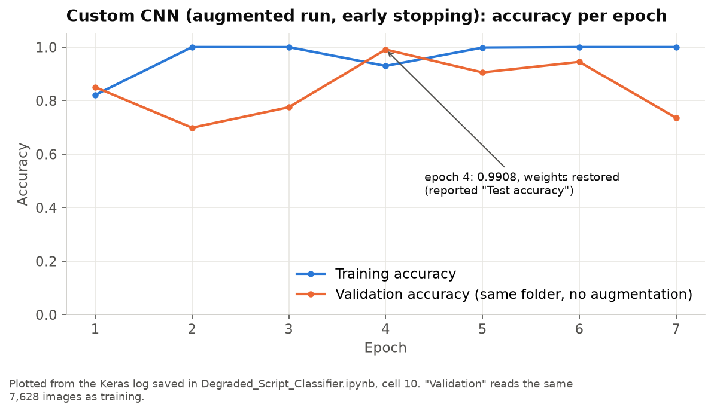
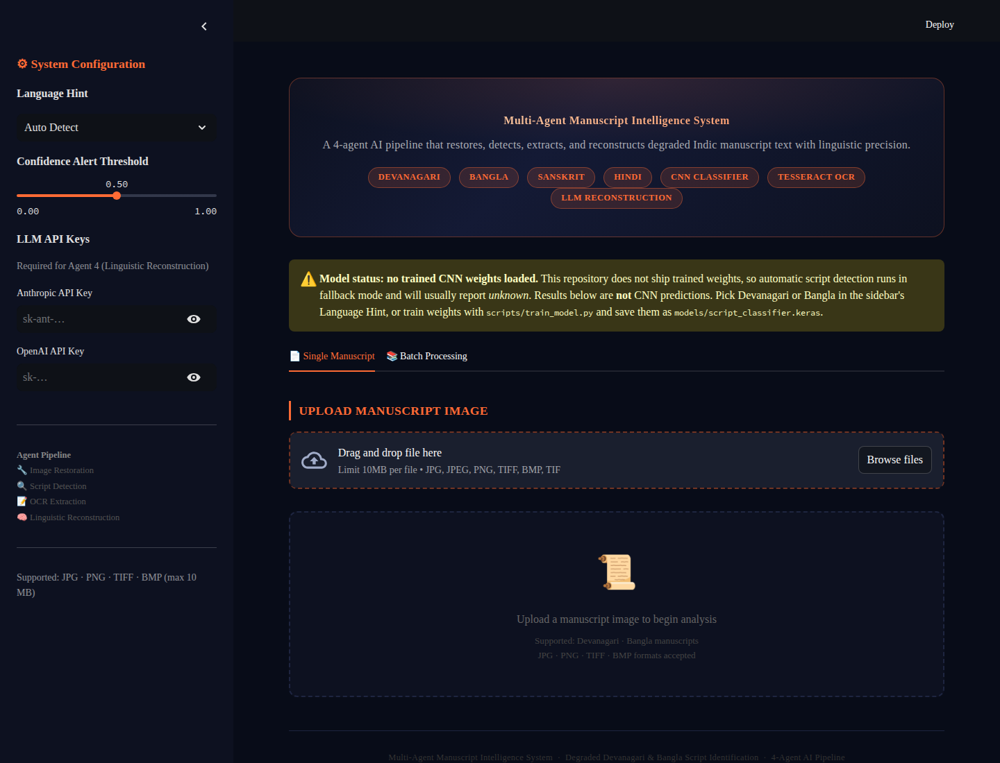
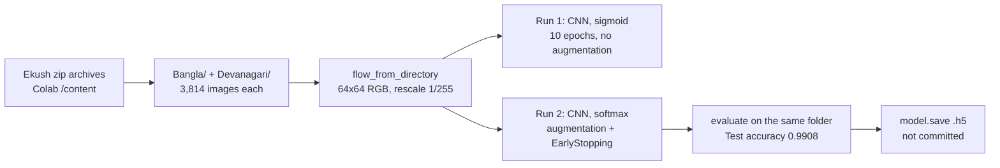
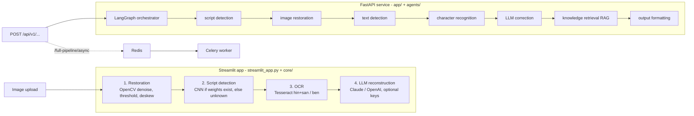

# Manuscript Intelligence: Devanagari & Bangla OCR

**A Keras CNN research notebook for Devanagari-vs-Bangla script identification, packaged with a Streamlit demo and a FastAPI + LangGraph multi-agent OCR service (Docker / Kubernetes manifests included).**

[](https://github.com/Akshatb848/Degraded-Devanagari-and-Bangla-Script-Identification-Using-CNN-Frameworks/actions/workflows/ci.yml)
[](LICENSE)
[](https://www.python.org/downloads/)


## Results at a glance

| Model (`Degraded_Script_Classifier.ipynb`) | Data | Reported accuracy | What it measures |
|---|---|---|---|
| Custom CNN, 3× Conv2D/MaxPool → Dense 128 → Dropout 0.5 → softmax; 64×64 RGB; augmentation; early stopping (patience 3, best weights restored) | 7,628 images, 3,814 per class folder (`Bangla`, `Devanagari`) | **99.08%** (`Test accuracy: 0.9908232688903809`) | Accuracy on the **same 7,628 images it was trained on** (non-augmented copy). Not a held-out score. |

<p align="center">
  
</p>

*Accuracy per epoch, redrawn by `scripts/make_figures.py` from the Keras log saved in the notebook (the notebook has no plots of its own). Early stopping ran 7 epochs and restored the epoch-4 weights, which is where the reported 0.9908 comes from.*

**Read the number with care.** Two things in the saved notebook outputs mean 99.08% is not evidence of script-identification accuracy yet:

1. The "validation"/"test" generator reads the same `/content/processed_data` folder as training, so there is no held-out data.
2. The two class folders print **identical file listings**: the same 3,814 Ekush-style file names (`1_MUN_16_1_1066.jpg`, `0_CHA_15_1_815.jpg`, …) in the same order. Ekush is a *Bangla* handwriting dataset. The notebook does not show where the Devanagari images came from, or how the two folders differ.

See [Limitations](#limitations-and-next-steps) for what a sound evaluation needs. VGG-16 / DenseNet-121 / ResNet-50 / AlexNet figures quoted in the original project notes ([README_DSC.md](README_DSC.md)) are **not** produced by anything in this repository and are not reported here.

## What is in the repo

1. **Research**: `Degraded_Script_Classifier.ipynb`, a Keras CNN that tells
   Devanagari from Bangla character images.
2. **Application**: a Streamlit demo app, plus a FastAPI service backed by a
   LangGraph multi-agent pipeline, a Celery worker for async jobs, and
   Docker / Kubernetes manifests.

> **Model status:** this repository contains **no trained weights**. Without
> them the apps run in a clearly labelled fallback mode. Script detection
> returns `unknown`, the API sets `model_status: "untrained_fallback"`, and
> Streamlit shows a warning banner. The [Training](#training-the-cnn) section
> shows how to produce weights.

<p align="center">
  
</p>

*The Streamlit app running locally from this branch, showing the fallback-mode banner.*

## Problem

Digitising Indic manuscripts needs the right OCR language model, and many
scans do not say which script they are in. Devanagari and Bangla are both
abugidas with a headline (*shirorekha*) and look similar once the page is
faded, stained or noisy. A reliable script classifier lets the pipeline
route each page to Hindi/Sanskrit or Bengali OCR before any text is read.

## Data

| | |
|---|---|
| Dataset named in the project | **Ekush**, a database of 367,018 isolated handwritten Bangla characters from 3,086 writers ([GitHub: ShahariarRabby/ekush](https://github.com/ShahariarRabby/ekush), [paper, RTIP2R 2018](https://link.springer.com/chapter/10.1007/978-981-13-9187-3_14)) |
| Licence | No formal open licence is stated; the authors describe it as freely available for academic research. Cite the paper if you use it. |
| Used in the notebook | 7,628 JPEGs in two folders, `Bangla/` and `Devanagari/`, 3,814 each, resized to 64×64 RGB |
| Devanagari source | **Not documented.** Both folder listings in the notebook contain the same Ekush file names (see above). |
| In this repo? | No. The notebook unzips the archives in Google Colab (`/content/...`). |

## Approach



The notebook's first run (sigmoid output, no augmentation) reaches 1.0000
training accuracy from epoch 2. The second run, the one reported above, adds
rotation/shift/shear/zoom/flip augmentation and early stopping on
`val_loss`. The application side is described next.

---

## Architecture



Each agent tries its stronger back-end first and falls back if that back-end
is not installed. For example, text detection tries YOLO, then docTR, then
OpenCV connected components. OCR tries TrOCR, then Tesseract. RAG uses
ChromaDB and falls back to basic dictionary validation. The heavy back-ends are
optional (`requirements-extras.txt`).

| Endpoint | Purpose |
|---|---|
| `GET /health` | Liveness, plus `model_status` of the CNN classifier |
| `POST /api/v1/detect-script/` | Devanagari / Bangla classification (`model_status`, `warning` fields) |
| `POST /api/v1/restore-image/` | Denoise / CLAHE / deskew / optional super-resolution |
| `POST /api/v1/ocr/` | Text detection + recognition (+ optional LLM correction) |
| `POST /api/v1/full-pipeline/` | All 7 agents, synchronous |
| `POST /api/v1/full-pipeline/async` | Queue the pipeline on Celery; poll `GET /api/v1/full-pipeline/status/{job_id}` |

Interactive API docs are at `http://localhost:8000/docs`.

---

## Running locally

Requires Python 3.11–3.13. For OCR, install Tesseract with the Hindi,
Sanskrit and Bengali language packs (`packages.txt` lists the Debian
packages: `tesseract-ocr tesseract-ocr-hin tesseract-ocr-ben`). Without
Tesseract the apps still start, but OCR returns no text.

```bash
python -m venv .venv && source .venv/bin/activate
pip install -r requirements-dev.txt        # runtime deps + pytest
cp .env.example .env                       # optional: ANTHROPIC_API_KEY / OPENAI_API_KEY
```

| Component | Command |
|---|---|
| **Streamlit app** | `streamlit run streamlit_app.py` → http://localhost:8501 |
| **API** | `uvicorn app.main:app --reload --port 8000` → http://localhost:8000/docs |
| **Worker** (needs Redis) | `redis-server` then `celery -A workers.celery_app worker --loglevel=info --queues=pipeline,detection` |

The API and worker read Redis/Celery URLs from the environment (defaults:
`redis://localhost:6379/0..2`). Redis is only needed for the `/async`
endpoint and the worker. Everything else runs without it.

All three commands above were run end to end against this branch, including
an async job going through Redis → Celery → status endpoint.

### Docker

```bash
cp .env.example .env
docker compose up --build        # api, worker, redis, postgres, chromadb, flower, nginx
```

To make the images load trained weights, build them with
`--build-arg WITH_TENSORFLOW=true`. The Docker setup itself was not
re-verified for this README (no Docker daemon was available). Kubernetes
manifests are in `k8s/`. See [DEPLOYMENT.md](DEPLOYMENT.md).

### Requirements files

| File | Contents |
|---|---|
| `requirements.txt` | Runtime for Streamlit, API and worker (no TensorFlow) |
| `requirements-train.txt` | + TensorFlow, to train or load the CNN |
| `requirements-extras.txt` | Optional agent back-ends: TrOCR/torch, YOLO, docTR, Real-ESRGAN, ChromaDB (unpinned, not part of CI) |
| `requirements-dev.txt` | + pytest, pytest-asyncio, httpx |

---

## Tests

```bash
pytest -q
```

This runs the API, schema, agent and model-status tests, plus
`tests/test_notebooks.py`, which validates both notebooks with `nbformat`,
checks that the figures quoted above appear in the notebook's saved outputs,
and checks that every README image exists. CI runs the same suite on Python
3.11 and 3.13 without TensorFlow. One test needs TensorFlow and is skipped with a reason when it is not
installed. Install `requirements-train.txt` to run it.

---

## Training the CNN

`scripts/train_model.py` trains the notebook's custom CNN (or VGG16,
DenseNet121 or ResNet50 transfer-learning variants) from a folder with one
sub-folder per class:

```
data/
├── Bangla/        *.jpg|png
└── Devanagari/    *.jpg|png
```

```bash
pip install -r requirements-train.txt
python scripts/train_model.py --data-dir data --output-dir saved_models --model custom_cnn --epochs 20
```

This writes `saved_models/script_classifier.keras`, using an 80/20
train/validation split with augmentation. It was smoke-tested on a small
synthetic dataset, not retrained on Ekush. To use the weights:

- **Streamlit** picks up `saved_models/script_classifier.keras` or
  `models/script_classifier.{keras,h5}` automatically.
- **API / worker**: set `MODEL_DIR=saved_models` (default
  `/app/saved_models` in Docker). `/health` then reports
  `model_status: {"cnn_classifier": "trained"}`.

Model input is 64×64 RGB scaled to [0, 1], with classes `Bangla=0` and
`Devanagari=1` (Keras `flow_from_directory` order).

---

## Research results

The figures, their caveats and the training curve are in
[Results at a glance](#results-at-a-glance). To redraw the chart from the
notebook's saved log (no training):

```bash
pip install matplotlib
python scripts/make_figures.py
```

---

## Project structure

```
├── Degraded_Script_Classifier.ipynb  research notebook (custom CNN)
├── streamlit_app.py                  Streamlit UI (4-step pipeline)
├── core/                             Streamlit pipeline: preprocessing, classifier, Tesseract OCR, LLM corrector
├── app/                              FastAPI service: main.py, routes/, schemas, config
├── agents/                           LangGraph orchestrator + 7 agents
├── models/cnn_classifier.py          CNN loader / inference used by the API & worker
├── services/                         Redis job-status cache, image helpers
├── workers/celery_app.py             Celery tasks for async pipeline jobs
├── scripts/train_model.py            CNN training
├── scripts/make_figures.py           redraws docs/images/dsc_training_curve.png from the notebook log
├── scripts/ingest_corpus.py          ChromaDB corpus ingestion for RAG (needs requirements-extras)
├── tests/                            pytest suite (incl. test_notebooks.py: nbformat + README-number checks)
├── docs/images/                      README figures
├── .github/workflows/ci.yml          CI: pip check + pytest on Python 3.11 and 3.13
├── Dockerfile, docker/, docker-compose.yml, k8s/   deployment
├── README_DSC.md, DEPLOYMENT.md      original project notes, deployment guide
└── LICENSE                           MIT
```

## Limitations and next steps

**Limitations**

- **No held-out evaluation.** The reported 99.08% is measured on the training
  images. The first run's 1.0000 "validation" accuracy comes from a
  `val_gen` defined outside the saved cells, so its data is unknown.
- **Class provenance is unclear.** Both class folders list the same Ekush
  (Bangla) file names, so it is not shown that the `Devanagari` class contains
  Devanagari script. A model can score highly by learning any systematic
  difference between the folders (for example, preprocessing).
- **Character-level, not page-level.** The model sees isolated 64×64
  characters; the apps classify whole manuscript images.
- **No trained weights are shipped**, so the apps run in fallback mode, and
  the multi-backend agents (YOLO, docTR, TrOCR, ChromaDB) are optional and
  not exercised in CI.
- **Docker / Kubernetes** manifests were not re-verified for this README.
- `docker-compose.yml` and `.env.example` contain local development
  placeholders (for example a default Postgres password); replace them
  before any real deployment.

**Next steps**

1. Assemble a documented two-script dataset: Ekush (Bangla) plus a public
   Devanagari set such as the UCI Devanagari Handwritten Character Dataset,
   with writer-disjoint train/validation/test splits.
2. Re-run `scripts/train_model.py` (custom CNN and the VGG16 / DenseNet121 /
   ResNet50 options) and report held-out accuracy, a confusion matrix and
   per-degradation-level results.
3. Add synthetic degradation (blur, stains, ink bleed) to the test set to
   measure robustness, which is the project's stated goal.
4. Publish the trained `.keras` weights as a release asset so the apps leave
   fallback mode.

## License

Code: [MIT](LICENSE) © 2026 Akshat Banga. Datasets are not redistributed;
their own terms apply.

## Author

**Akshat Banga**, AI Generalist and AI transformation. [GitHub](https://github.com/Akshatb848)
